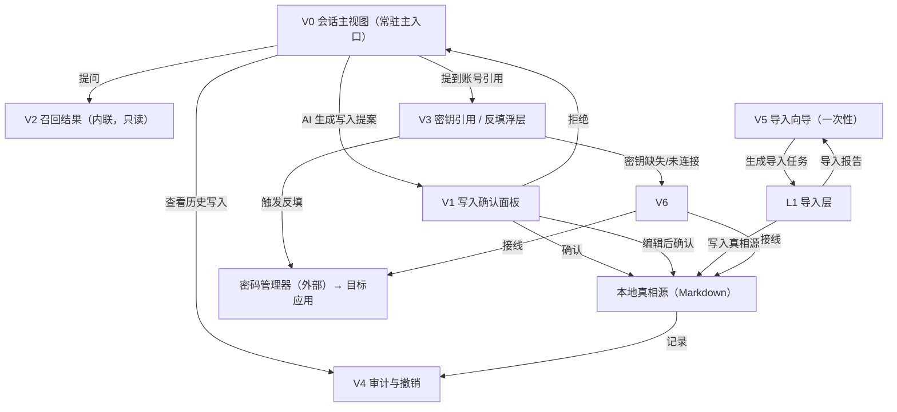
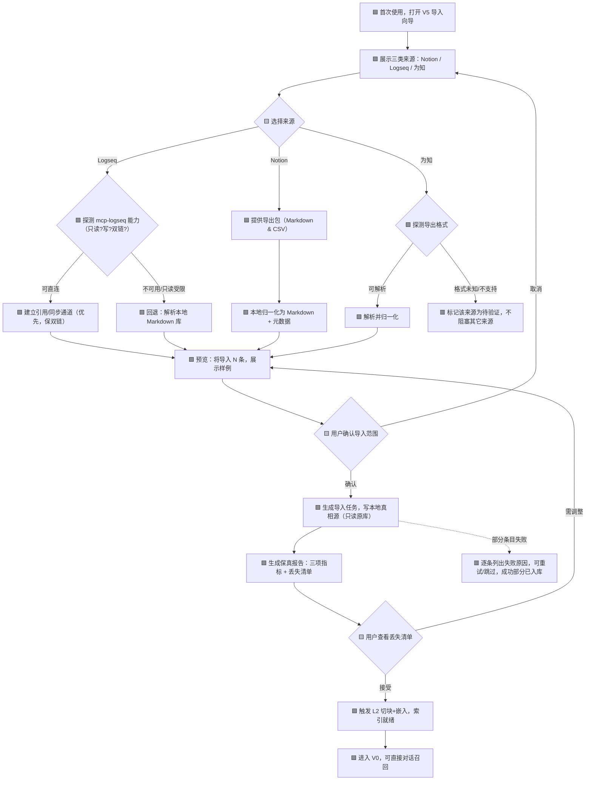
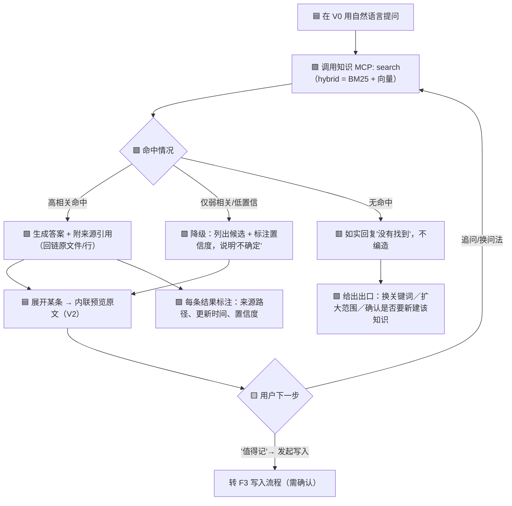
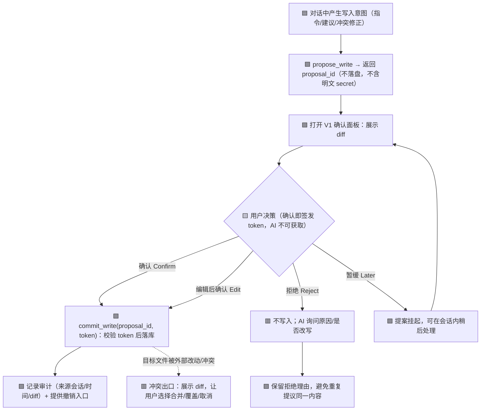
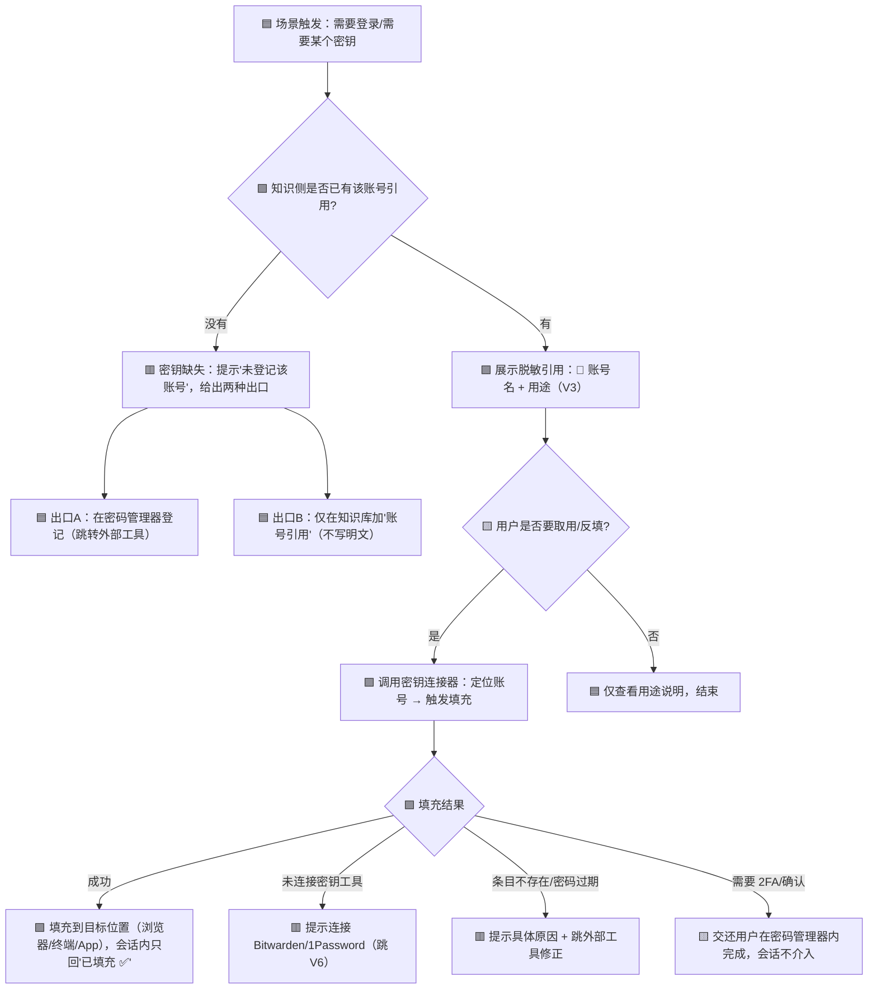

# 03 关键流程与交互设计（含写入边界）

> 任务：T3 关键流程与交互设计 · 作者：交互设计师
> 输入证据：`docs/ai-knowledge-system-qa.md`（调研结论）+ `01-users-and-scenarios.md`（T1 用户与场景研究）+ `02-scope-and-capability-architecture.md`（T2 产品定位、范围与能力架构）
> 既定约束：**本地可控、自己接 MCP**；**对话优先、弱化界面**；**读放开、写收紧**；**知识库零明文**
> 标记约定（沿用上游）：`[E]` 有直接证据 · `[A]` 假设 · `[Q]` 待验证 · `[→T2 §x]` 与 T2 能力域/编号的对应
> **修订（T7，承 T5 §5.3 缺口）**：§5.1 增补**两阶段写入协议**（`propose_write` → `commit_write` + 用户签发的 `confirmation_token`），把"无静默写入"从 UI 约定**下沉到 MCP 协议层**；F3 与 E-08/E-10 同步更新，新增 E-17。其余章节主体结论不变。
> **快照注记（T12）**：本文为设计输入快照，边界与计数口径随主方案演进；如与主方案出现不一致，**最终口径以主方案《AI知识系统-设计方案.md》为准**。
> **变更登记（T14，2026-10-17 · 主方案 v1.1）**：本分册正文未改写。因用户三项决策回填主方案，与本文相关的口径以主方案为准：① **UI 呈现验证降级**——真实浏览器渲染/无障碍（含密钥脱敏 P1/P2 呈现、WCAG 2.1 AA）推迟至实现阶段，相关视觉/无障碍细则**待实现阶段补验**，本文不视为已验证；② **密码管理器锁定 Bitwarden**（原"1Password/Bitwarden"收敛）；③ **为知笔记改道**——已导出为 Markdown、走通用 Markdown 通路，**不再单列独立适配层/最高成本**。以上均以主方案 §1/§3/§5/§6/§9 与附录 A 为准。
> **变更登记（T16，2026-10-17 · 主方案 v1.2）**：本分册正文未改写。对三项 `[Q]` 的澄清以主方案为准：① **反填端到端（Q4）**——主用途锁定为「**供 AI agents 使用**」（agent 运行时按引用取用凭据），**人手工反填（表单/浏览器）暂不考虑但保留可能性**；仍只承诺"指针化 + 运行时取用 + 脱敏"（明文不经知识库、不呈现）；② **混合召回基线（R2）**——下一步路径 = **先连通 Logseq 与为知（Markdown）数据 → 再由 AI 辅助用户共建评测语料（query set）**；③ **真实客户端支持面（Q16/R11）**——目标锁定 **Cursor** 与 **deepseek harness**。以上以主方案 §4/§6/§9/§10 与附录 A 为准。
> **变更登记（T28，2026-10-17 · 主方案 v1.4）**：本分册正文未改写，为**输入快照**；**T27 的 M2 向量 hybrid 实测结论**以主方案为准：**M2 由 `[Q]` 转 `[实测]`**（限"单次运行 / 未择优 / 26 条样本"）、**但未强于 BM25-only**（主口径全面落后），**仅救回 BM25 跨语言盲区**（Q13/Q15/Q16 → top-17/3/12）；本文"**召回强于关键字**"仍为**目标**（非已实现），F1 检索流程按 hybrid（BM25+向量）理解不变。以上以主方案 §4.2/§9/§10 与附录 A 为准。
> **变更登记（T23，2026-10-17 · 主方案 v1.3）**：本分册正文未改写，为**输入快照**；本轮三项 spike 结论以主方案为准：① **召回基线（T20）**——BM25-only 已建（recall@1 0.6154 / @5 0.8462 / MRR 0.7003），**"强于关键字"仍未实现**（M3 未胜、M2 未验证；跨语言为 BM25 硬盲区）；② **导入（T21）**——为知**跳过**、能力并入通用"带附件 Markdown 目录"；**丢失清单升一等产物**（入 job `errors[]`）、**解析器鲁棒性 + 自检列强制机制**、附件"只索引按需取用"；③ **宿主（T22）**——连接器宿主级 SQLite 管理且支持 stdio、宿主内置审批记录子系统、**挂载须宿主侧动作**，渲染/审批仍 `[Q]`（R11/Q16）。以上以主方案 §3/§4/§7/§9/§10 与附录 A 为准。

---

## 0. 本文如何使用

- **承接 T2**：本文的每个流程都挂到 T2 的能力域（L1–L6）与 MVP 组件（M1–M7），不新增范围。
- **给 T4（视觉）**：第 3 节"视图关系"给出最小 UI 的视图清单与职责；第 5 节给出确认面板/密钥脱敏的信息层级。
- **给 T5（验证）**：第 6 节"状态与异常边界"是可直接转成测试用例的清单；第 5 节确认闸规则可验证"100% 写入可确认"。
- **给 T6（汇总）**：本文即最终文档"AI 会话交互与写入边界"章节的骨干。

**对齐声明**：本文不引入 T2 未列出的能力。凡 T2 标 `[Q]` 的未决项（确认粒度 Q5、反填场景 Q4、mcp-logseq 能力 Q3），本文按"**默认策略 + 可切换开关**"设计，使未决项不阻塞交互定型。

---

## 1. 设计原则与交互总则

从 T1 §7.1、T2 §2.5 提炼，本文所有交互据此收敛：

| # | 原则 | 含义 | 依据 |
|---|------|------|------|
| P1 | **对话是唯一主入口** | 检索、录入、取用都从会话发起；不做 Notion 式目录/排版/看板 | `[E]`诉求①；`[→T2 §1.3 N1]` |
| P2 | **读放开、写收紧** | 召回不设确认；任何写入（新增/修改/删除）必须过用户确认闸 | `[E]`诉求⑥；`[→T2 L5]` |
| P3 | **最小界面只做四件事** | 界面仅承载：确认（写入门）、查看（结果/引用）、撤销与审计（治理）、状态可见性 | `[A]`T1 §7.2；`[→T2 L5]` |
| P4 | **密钥以"引用"出现，不以"值"出现** | 会话与知识库只见账号名/用途/引用符，永不见明文 secret | `[E]`S4/S9；`[→T2 L3/L4]` |
| P5 | **每个异常都有出口** | 未找到、不确定、缺密钥、被拒、失败——都必须给出"下一步怎么办"，不留死路 | `[A]`本文补充（T1 §4 痛点） |
| P6 | **本地可控优先** | 断网时核心召回仍可用；换助手不迁移数据；索引可重建 | `[E]`前提 S8；`[→T2 §6.4]` |

**贯穿全局的一条硬规则**：会话中 AI 的每一个"写入意图"都是**提案（Proposal）**，不是**动作（Action）**。提案必须经用户确认才由知识 MCP 执行。这条同时是 T2 §6.3 验收标准（100% 写入经显式确认）的交互落点。

---

## 2. 信息架构（IA）

### 2.1 核心实体（Entity）

| 实体 | 说明 | 归属层 | 真相源 |
|------|------|--------|--------|
| **知识条目 Knowledge Note** | 一条可被召回的知识（Markdown 文件/段落） | L2 | 本地文件 ✅ |
| **索引 Index** | 条目切块+嵌入的检索结构 | L2 | 可重建，非唯一存储 |
| **会话 Session** | 一段人-AI 对话，是召回与写入提案的发生地 | L5 | 可选留存 |
| **写入提案 Write Proposal** | AI 生成的"待确认写入"对象（含 diff） | L5 | 临时 |
| **账号引用 Account Ref** | "哪有账号、怎么用"的引用条目（**无明文**） | L3 | 本地文件 ✅ |
| **密钥条目 Secret Entry** | 真正的凭据 | L3 | **外部**（1Password/Bitwarden） |
| **反填动作 Autofill Action** | 用户触发的一次填充 | L4 | 事件 |
| **审计记录 Audit Log** | 谁/何时/由哪次会话写入或撤销 | L5/治理 | 本地 ✅ |
| **导入任务 Import Job** | 一次历史笔记搬迁任务及其保真度报告 | L1 | 本地 |

### 2.2 知识域 vs 密钥域（物理隔离）

```
   知识域（本地文件为真相源）            密钥域（外部管理器）
   ┌────────────────────────┐          ┌────────────────────────┐
   │ 知识条目 ── 索引         │          │ 密钥条目（明文只在此）   │
   │ 账号引用（仅"哪有/怎么用"）│──引用──▶│ 账号名 ⇄ secret         │
   └────────────────────────┘  ref     └────────────────────────┘
        ▲ 仅通过 MCP: search/add/update        ▲ 仅通过取用/填充接口
        └──────────────  AI 会话  ─────────────┘
              （AI 可读"引用"，不可读 secret 明文）
```

**关键交互含义**：AI 在会话里提到某个账号时，展示的是**引用符**（如 `🔑 acme-cloud-prod`），而不是密码；要拿到密码，用户必须显式触发一次**反填动作**（见 F4），该动作走密钥连接器，不经过 AI 上下文。`[→T2 L3 隔离级别待定，建议按"不接触明文"设计]`

### 2.3 视图与能力的映射

| 能力域（T2） | 承载的视图/交互 |
|--------------|-----------------|
| L1 导入层 | V5 导入向导、导入报告 |
| L2 存储与召回层 | V2 召回结果、V1 写入提案的 diff |
| L3 安全与密钥层 | V3 密钥引用视图（脱敏） |
| L4 反填层 | V3 反填浮层 |
| L5 AI 会话与写入边界层 | V0 会话主视图、V1 确认面板、V4 审计/撤销 |
| L6 配置与适配层 | V6 设置（MCP 接线、密钥工具连接） |

---

## 3. 页面 / 视图关系

"弱化界面"不等于"没有界面"：**常驻的只有 V0 会话**，其余都是**按需唤起的轻量面板/浮层**，用完即收，不构成需要人工维护的导航体系。

### 3.1 视图清单

| 视图 | 名称 | 职责 | 常驻? | 可写? |
|------|------|------|-------|-------|
| **V0** | 会话主视图 | 唯一主入口：提问、召回、发起写入 | ✅ 常驻 | 仅发起提案 |
| **V1** | 写入确认面板 | 展示待写入内容 diff、确认/编辑/拒绝 | 按需 | ✅ 确认后落库 |
| **V2** | 召回结果视图 | 内联于 V0，展示命中条目、来源、置信度 | 内联 | ❌ 只读 |
| **V3** | 密钥引用视图 / 反填浮层 | 展示脱敏引用、触发反填 | 按需 | ❌ 只触发填充 |
| **V4** | 审计与撤销视图 | 写入历史、来源会话、撤销入口 | 按需 | ✅ 撤销 |
| **V5** | 导入向导 | 选来源→预览→导入→保真报告 | 一次性 | ✅ 建导入任务 |
| **V6** | 设置 / 配置 | MCP 接线、密钥工具连接、查看存储路径 | 按需 | 改配置 |

### 3.2 视图关系图



### 3.3 导航模型（为什么不是目录树）

- **默认无导航栏**：进入即在 V0，用户用自然语言表达意图（"上次那个 OAuth 的坑"）。
- **面包屑一律是"来源引用"而非"文件夹路径"**：召回结果标注 `来源：logseq/dev/oauth.md#L42`，点开即跳原文（本地编辑器/内联预览），符合"本地文件为真相源"。
- **不做多级菜单**：V1–V6 通过会话指令或轻量入口唤起（如 `/review`、`/secrets`），呼应 T2 §1.3 N1。

---

## 4. 关键流程

> 图例：🟦 用户动作 · 🟪 AI/系统动作 · 🟨 确认/决策点 · 🟥 异常出口

### F1 首次接入与历史笔记导入

**目标**：把 Notion / Logseq（mcp-logseq）/ 为知笔记的历史知识搬入本地真相源，尽量保留结构，且**不改动原工具数据**。`[→T2 L1 / M6]`

**关键交互决策**：
- Logseq 走**两条通路**：`[Q]` 若 mcp-logseq 可只读直连，则优先"引用/同步"（不复制，双链保留最好）；否则退路为解析其本地 Markdown 库。`[→T2 L1][Q](T1 Q3)`
- Notion 走**官方导出（Markdown & CSV）→ 本地归一化**。
- 为知笔记：`[Q]` 导出格式未确认，**先出"格式探测"步骤**，探测失败不阻塞其余来源。`[→T2 L1][Q](T1 Q2)`
- **保真度必须显式**：每条通路产出"条目数一致率 / 标签·双链保留率 / 附件可用率"，无法保留项进**丢失清单**，**不静默丢弃**。`[→T2 L1 保真度目标][→T2 §6.5]`



**首次接入的其它前置步骤**（可与导入并行，来自 T2 §4 起步最小集）：
1. 指定**本地笔记目录**（M1，真相源）——默认给一个建议路径，用户可改。
2. 接**知识 MCP**（M2）与**密码管理器**（M3）——在 V6 完成接线，连接状态在 V0 顶部常显一个小圆点（🟢召回可用 / 🟡密钥未连 / 🔴离线）。
3. 若跳过导入（空库起步），V0 直接可用，导入可在任意后续时点从 V5 补做。

**边界**：导入是**一次性迁移优先**，原工具持续双向同步**首版不做**。`[→T2 N7][Q](T1 Q12)`

---

### F2 对话式检索与召回呈现

**目标**：对话即检索，召回结果**强于关键字**（语义/换述/模糊记忆），且**未找到时如实说"没找到"**。`[→T2 §6.1][→T2 L2]`

**"强于关键字"如何在交互上体现**（与 T2 §6.1 指标对应）：
- 用户可用"意思"而非"词"提问（"那个让 token 过期的坑"）。
- 结果按**相关性排序**而非匹配词数；命中的是**语义块**，回链到原条目。
- 支持**换述提示**：当精确词无命中但语义有命中时，明确告知"没有出现'XXX'字样，但按意思找到以下 N 条"。



**召回结果呈现规范**（V2）：

| 元素 | 必须展示 | 说明 |
|------|----------|------|
| 答案 | ✅ | 基于命中的语义块生成，禁止无来源编造 |
| 来源引用 | ✅ | 本地路径 + 行号/段落锚点，可一键跳原文 |
| 更新时间 | ✅ | 帮助用户判断新旧（多版本时关键） |
| 置信度 | 低置信时必显 | 🟢高 / 🟡中 / 🔴低；低置信必须用文字说明"可能不准确" |
| 命中依据 | 换述场景必显 | 说明是"按语义"还是"按词"命中，让"更强"可感知 |
| 冲突提示 | 多版本时必显 | 见 F2 异常 E-04 |

**边界与出口**：无结果、AI 不确定、多版本冲突，见第 6 节 E-01/E-02/E-04。**召回永远不弹确认**（P2 读放开）。

---

### F3 会话录入 / 更新 + 用户确认闸（核心流程）

**目标**：用自然对话录入/更新知识，**任何写入都经用户确认**；AI 的"建议落库"同样走确认。`[→T2 L5 / M4 / M5][→T2 §6.3]`

**写入是怎么被触发的（三个入口，全部归一为"提案"）**：
1. **显式指令**：用户说"把这条记下来"。
2. **AI 建议落库**：AI 在对话中识别到"值得记的点"，主动**提议**（不直接写）。`[Q](T1 Q14)`
3. **既有知识更新**：AI 发现回答与库里旧条目冲突，提议**修正**（update）。



> 注（T7）：上图落库动作走**两阶段写入协议**——`propose_write` 只产出 `proposal_id`（不落盘），`commit_write(proposal_id, confirmation_token)` 需用户确认动作签发的 token；**AI 不可获取 token**，无法自行提交；第三方写工具（如 `logseq-mcp`）同样纳入此闸。详见 §5.1。

**V1 确认面板必须展示的内容**（信息层级，供 T4 细化）：
1. **动作类型**：新增 / 修改 / 删除（删除用最强视觉警示）。
2. **目标位置**：是新建条目，还是更新哪个已有条目（给路径）。
3. **内容 diff**：新增部分高亮；修改用增删行；**删除必须先展示被删内容全文**。
4. **来源**：来自哪次会话、AI 的置信度、AI 认为"为什么值得记"。
5. **安全扫描结果**：若提案中疑似含 secret，**拦截并提示"检测到疑似密钥，请改用密钥工具"**（见 §5.4）。
6. **操作**：确认 / 编辑后确认 / 拒绝 / 暂缓。

**确认粒度**（`[Q]` T1 Q5 未决 → 默认策略 + 开关）：

| 场景 | 默认粒度 | 可切换 | 说明 |
|------|----------|--------|------|
| 单条新增 | **逐条确认** | 固定 | 最小安全单位 |
| 同一会话内的多条新增 | **批量确认**（一屏列出全部 diff，可逐条勾选/取消） | 可降级为逐条 | 减少打断 |
| 修改已有条目 | **逐条确认** | 固定 | 改错代价高 |
| 删除 | **逐条确认 + 二次确认** | 固定 | 最高风险 |
| 读（召回） | **无需确认** | 固定 | P2 读放开 |

**被拒后的处理**（`[E]`任务要求）：见 §5.5。

**撤销与审计**：每次确认写入后生成审计记录；提供**撤销窗口**（默认建议 1 次会话内/24 小时 `[A][Q]`），撤销即反向操作并记录。V4 可查"这条是谁、什么时候、由哪次会话加的"。`[→T2 §6.3]`

---

### F4 密码 / 密钥访问与快速反填

**目标**：会话中能"用"到密钥，但**知识库与会话零明文**；反填由用户**主动触发**，路径**不经过 AI 上下文**。`[→T2 L3 / L4 / M3 / M7]`

**核心隔离规则**（`[E]`S9、`[→T2 L3 建议按"不接触明文"设计]`）：
- 知识库只存**账号引用**（`账号名 + 用途 + 位置`），例如 `acme-cloud-prod（生产环境控制台，需 2FA）`。
- AI 只能读**引用**，读到的是 `🔑 acme-cloud-prod`，**不是密码**。
- 取到真值只有一条路：用户触发反填 → 密钥连接器 → 目标应用，**明文不出现在会话、不进 LLM 上下文**。



**反填触发与展示方式**：
- **触发**：由用户在 V3 或会话指令显式触发（"帮我把 acme 的密码填到当前登录页"）。**不做自动静默填充**。`[E]`"反填动作由用户主动触发"`[→T2 L4]`
- **展示**：会话中只呈现**动作结果**（"已填充" / "需要你在密码管理器确认 2FA"），**永不回显密码本身**，也不写入会话记录。
- **场景范围**：`[Q]` 具体场景（浏览器/终端/App）未确认（T1 Q4）→ **首版只做最可能的一种**（默认浏览器扩展填充），避免过度设计。`[→T2 M7 P1]`

---

## 5. 用户确认闸（专项：位置与规则）

> 这是诉求⑥的落点，也是 T2 §6.3 验收标准的交互定义。**不可妥协**。

### 5.1 闸门位置与强制机制（在哪里拦、靠什么保证）

**拦截点：知识 MCP 的写入口。** 任何写入路径——用户显式指令、AI 建议落库、导入以外的增量修改——都必须先构建 Proposal、再经 V1 确认、最后才落盘。

**强制机制（T7 修订，承 T5 §5.3 缺口）**：仅"拦在 UI 前面"**不足以保证** 100% 可确认——若知识 MCP 暴露**无条件**的 `add`/`update`，AI 客户端可直接调用绕过确认面板。因此把保证从"UI 约定"下沉到**协议层**：

- **知识 MCP 不得暴露无条件写工具**（不暴露裸 `add` / `update` / `delete`）。
- 写操作一律走**两阶段写入协议**：`propose_write(...)` → `commit_write(proposal_id, confirmation_token)`。
- **`confirmation_token` 仅由用户确认动作签发**（客户端确认面板 / CLI 确认），**AI 侧不可获取**；无 token 或 token 无效的 `commit_write` **必须被拒**。
- 该约束对**所有写工具统一生效**：包括第三方（如 `logseq-mcp` 的 create/update/delete）与导入 MCP 的写工具——**第三方写工具也必须纳入同一确认闸**，否则会被旁路。
- 若宿主客户端提供**工具调用审批钩子**，可作为第二道保险，但**不单独依赖**它。
- 表述口径：在真机实测通过前，"100% 写入可确认"表述为**设计目标 + 已定强制机制**，不写成"已实现"。`[A][Q]`

```
用户/AI 写入意图
      │
      ▼
构建 Proposal（含 diff、目标、来源）──▶ 安全扫描（疑似 secret？）
      │                                        │命中
      │                                        ▼
      │                                🟥 拦截：改用密钥工具
      ▼
① propose_write(proposal) ─▶ 返回 proposal_id + diff（不落盘）
      │
      ▼
 V1 用户确认闸 ──(用户确认动作)──▶ 签发 confirmation_token（AI 不可获取）
      │                                    │
      │                          ② commit_write(proposal_id, token)
      │                                    │
      │                     无 token / token 无效 ─▶ 🟥 拒绝写入（记审计）
      │                                    │有效
      ▼                                    ▼
   拒绝/暂缓 ─▶ 回到会话              落库 ─▶ 审计 + 撤销入口
```

### 5.2 确认分级决策表

| 操作 | 是否需确认 | 粒度 | 可撤销 | 备注 |
|------|------------|------|--------|------|
| search（读/召回） | ❌ 不需要 | — | — | 读放开 |
| add（新增单条） | ✅ 必须 | 逐条 | ✅ | |
| add（同会话多条） | ✅ 必须 | 批量，可逐条勾选 | ✅ | 减少打断 |
| update（改已有） | ✅ 必须 | 逐条 | ✅ | 必展示前后 diff |
| delete（删） | ✅ 必须 | 逐条 + 二次确认 | ✅（限期） | 必展示被删全文 |
| AI 建议落库 | ✅ 必须 | 同 add | ✅ | `[Q]`T1 Q14，默认**算写入** |
| 导入（L1 建任务） | ✅ 必须 | 一次性预览确认 | 导入任务可回滚 | 见 F1 |
| 反填（L4） | ✅ 由用户主动触发 | — | 动作本身不可撤，可补填 | 不问确认，但要主动触发 |

> **协议层映射（T7）**：上表的"确认"在协议层即**用户确认动作签发 `confirmation_token`**；`search` 对应无 token 的只读工具；**所有写工具（含第三方 `logseq-mcp` 写工具）一律映射到 `propose_write` / `commit_write`，无例外**。

### 5.3 确认的最小充分信息（"知情同意"四要素）

用户在点"确认"前必须能回答：**改什么**（diff）、**改哪**（目标条目）、**怎么来的**（来源会话/AI 置信度）、**能不能反悔**（撤销窗口）。四者缺一，确认面板即不合规。

### 5.4 特殊：疑似密钥混入写入

若 Proposal 内容中检测到疑似 secret（高熵串、`password=`、私钥块等 `[A]` 检测启发式）：
1. **拦截**，不写入。
2. 提示："检测到疑似密钥/凭据。知识库不存明文，请改用密钥工具登记，知识条目里只保留账号引用。"
3. 提供出口：转 L3 密钥登记 / 仅写脱敏后的账号引用 / 放弃。
`[→T2 §6.2 明文 secret 命中数 = 0]`

### 5.5 被拒绝后的处理

| 拒绝情形 | 系统行为 | 用户可见 |
|----------|----------|----------|
| 用户直接拒绝 | 不写入；记录拒绝理由（可选） | 会话回到正常；AI 不重复提议同一内容 |
| 用户编辑后仍不确认 | 保留 draft，供稍后再改 | 面板可重开，draft 不丢 |
| 多次拒绝同一内容 | AI 停止主动提议该内容 | 不打扰，除非用户再提起 |
| 拒绝后发现其实是想要的 | 从 V4/draft 找回，重新走确认 | 有一条"未采纳提案"记录 |

**原则**：拒绝**零副作用**——拒绝不部分写入、不留下半成品、不改变索引。

### 5.6 未决项的默认策略（防阻塞）

`[Q]` T1 Q5（确认粒度）未定 → 本文默认**逐条为主、批量可开关**；Q14（建议落库）未定 → 默认**算写入必须确认**；这两个开关若最终访谈结论相反，只需翻转配置，不改交互骨架。

---

## 6. 状态与异常边界（可转测试用例）

> `[→T5]` 每行 = 一个测试用例。所有异常都必须有**用户可见出口**（P5）。

| ID | 场景 | 触发 | 系统行为 | 用户可见 | 出口 |
|----|------|------|----------|----------|------|
| **E-01** | 检索无结果 | 召回 0 命中 | 不编造，明确"没找到" | "知识库里没有找到相关内容" | 换关键词 / 扩大范围 / 新建该知识（转 F3） |
| **E-02** | AI 不确定/低置信 | 命中弱、语义模糊 | 降级为候选列表 + 标置信度 | 🟡/🔴 + "以下可能相关，请确认" | 追问澄清 / 查看原文 / 自行判断 |
| **E-03** | 召回结果为空但知识存在（索引未就绪） | 新建/导入后索引未完成 | 提示索引状态 | "索引构建中（约 N 秒）" | 等待 / 用关键字兜底 |
| **E-04** | 多版本 / 召回冲突 | 同一主题多条且不一致 | 并列展示 + 标更新时间 | "发现 2 条不一致记录" | 让用户选权威版本，可选发起 update（转 F3） |
| **E-05** | 密钥缺失 | 需要的账号引用不存在或未登记 | 不猜测、不索要明文 | "未登记该账号" | 登记引用 / 外部工具登记 |
| **E-06** | 密钥工具未连接 | 反填时连接器不可用 | 不阻塞其它功能 | "密码管理器未连接" | 跳 V6 接线 |
| **E-07** | 反填失败 | 条目不存在/密码过期/需 2FA | 如实报错，不重试静默填充 | 具体原因 | 外部工具修正 / 手动 |
| **E-08** | 确认被拒绝 | 用户点"拒绝"（**不签发 token**） | 零副作用：proposal 作废，不落盘 | 回到会话 | 改写后再提 / 放弃 |
| **E-09** | 写入冲突 | 确认时目标文件被外部改动 | 不覆盖，展示冲突 diff | "文件已被外部修改" | 合并 / 覆盖 / 取消 |
| **E-10** | 写入失败 | `commit_write` 时磁盘/权限/MCP 错误 | 保留 draft 与 proposal_id | 失败原因 | 重试 / 另存路径 |
| **E-11** | 导入部分失败 | 某些条目格式不支持 | 成功部分已入库，失败逐条列出 | 失败清单 + 原因 | 重试 / 跳过 / 手工补 |
| **E-12** | 为知格式不可解析 | 格式探测失败 | 标记该来源待验证，不阻塞其它 | "为知导出格式待验证" | 换导出方式 / 暂缓该来源 |
| **E-13** | MCP 断连 / 断网 | 连接器不可用 | 核心召回仍可本地降级 | 顶部状态点 🔴 | 恢复后自动重连 |
| **E-14** | 撤销窗口过期 | 超过撤销时限 | 不提供一键撤销 | "该写入已超出撤销窗口" | 手动反向修改（转 F3） |
| **E-15** | 疑似密钥混入写入 | Proposal 含疑似 secret | 拦截不写 | 安全提示 | 转密钥工具 / 脱敏引用 |
| **E-16** | 用户想直接改文件 | 用户绕过会话编辑本地 md | 允许（本地可控），索引按需重建 | 提示"检测到外部修改" | 重建索引 |
| **E-17** | AI 尝试绕过确认直调写工具 | AI 直接调用写工具（含第三方 `logseq-mcp` write） | MCP 无无条件写工具；`commit_write` 无有效 token 即被拒，**写入不发生** | 不产生静默写入（必要时审计记录一次被拒直调） | 必须改经用户确认（propose → commit） |
| **E-18** | 提案过期（proposal_ttl 到期未确认） | `propose_write` 产出的 `proposal_id` 在 `proposal_ttl` 内未被确认 | 提案**作废、不落盘、零副作用**；对应 `commit_write` 被拒（`proposal_expired`）；**与 E-14 的撤销窗口 TTL（`undo_window`）分属两阶段协议的两个独立 TTL**（前者=确认前作废、从未落盘；后者=确认后撤销、已落盘但超时不可一键撤） | "该提案已过期，请重新发起" | 重新发起写入（转 F3，propose → commit） |

**状态可见性总则**：V0 顶部常显三个状态——**召回可用性**（🟢/🟡/🔴）、**密钥工具连接**、**索引状态**。用户任何时刻都能回答"我在哪、能不能用、下一步去哪"。

---

## 7. 关键交互文案原则（供 T4/T5）

1. **如实优先**：未找到就说未找到，低置信就说不确定，**永远不用流畅的编造掩盖不确定**。
2. **区分"读"与"写"的语气**：读是轻的、即时的；写是重的、需停顿的——视觉与文案都要让写入"有重量"。
3. **密钥永不回显**：任何状态、日志、会话记录里都不得出现明文 secret 的渲染路径。
4. **每个错误都给"下一步"**：错误文案 = 发生了什么 + 为什么 + 可以怎么办（三件套）。
5. **撤销承诺要诚实**：能撤销才说能撤销，且给出明确窗口。

---

## 8. 对下游任务的输入（TL;DR）

- **给 T4（视觉）**：
  - 最小 UI = V1 确认面板 + V2 召回结果 + V3 密钥脱敏 + V4 审计/撤销 + 状态可见性，**无导航体系**。
  - 密钥一律掩码/引用（`🔑 账号名`），**无明文渲染路径**；确认面板需清晰的 diff 与"写入有重量"的视觉层级；删除用最高警示。
- **给 T5（验证）**：
  - 第 6 节 **18 条**边界可直接转测试用例；重点验：**无静默写入**（100% 写入过确认，机制 = 两阶段写入协议，见 §5.1）、**未找到不编造**、**明文 secret 零渲染**、**确认被拒零副作用**、**反填不经 AI 上下文**。
  - **协议层必测**（对齐 T5 §9.A）：无 `confirmation_token` 时 `commit_write` 必须被拒；第三方 `logseq-mcp` 写工具无法旁路确认闸。
- **给 T6（汇总）**：本文对应最终文档"AI 会话交互与写入边界"章节；F3 + §5（含 §5.1 两阶段写入协议）即"写入确认闸"的完整定义；"100% 写入可确认"应表述为**设计目标 + 已定强制机制**，实测通过前不写成"已实现"。

---

## 9. 未决与假设（承接 T1/T2）

| 项 | 状态 | 本文默认处理 | 影响 |
|----|------|--------------|------|
| 写入确认粒度（逐条/批量） | `[Q]`T1 Q5 | 逐条为主，批量可开关 | 只翻开关，不改骨架 |
| AI 建议落库是否需确认 | `[Q]`T1 Q14 | 默认**算写入，需确认** | 关闭开关可放宽，但不建议 |
| 反填场景（浏览器/终端/App） | `[Q]`T1 Q4 | 首版只做浏览器填充 | 影响 L4 实现面 |
| mcp-logseq 能力 | `[Q]`T1 Q3 | 优先直连，退路解析 md | 影响 F1 Logseq 通路 |
| 为知导出格式 | `[Q]`T1 Q2 | 先探测，失败不阻塞 | 影响 F1 为知通路 |
| Agent 是否可读 secret 明文 | `[Q]`T1 Q11 | **按"不接触明文"设计** | 决定 F4 隔离级别 |
| 撤销窗口时长 | `[A]`本文 | 建议 1 会话内 / 24h | 待用户确认 |
| 真相源形态（纯 md vs 向量库） | `[Q]`T1 Q10 | 假设纯 Markdown + 可重建索引 | 影响 E-03/E-16 |
| 写入确认的强制机制 | **已定 `[A]`**（T7） | 两阶段协议 `propose_write` / `commit_write`，token 仅用户签发、AI 不可获取 | 动工前实测（T5 §9.A） |

**贯穿性前提**：全部证据来自单人自述（T1 证据强度声明），本交互设计的用户模型随验证结果可能调整。`[A]`

---

*本文为 T3 交付物。所有流程挂接 T2 能力域（L1–L6 / M1–M7），未新增范围；凡 `[A]`/`[Q]` 项不得当作既定事实。*